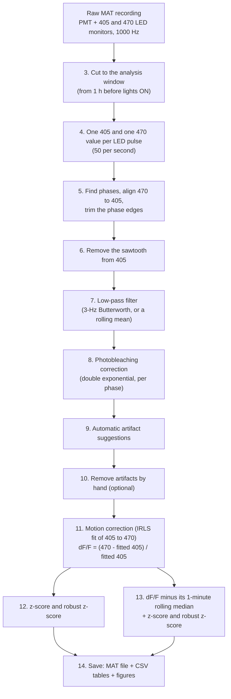

# Calcium Fibre-Photometry Preprocessing (MATLAB)


A step-by-step MATLAB pipeline that turns a raw, long (e.g. 49-hour) fibre-photometry
recording into clean calcium signals: **dF/F** and its **z-scores**, saved
**with and without a 1-minute rolling median**.

It was written for beginners: you open one script, click **Run**, choose your
file and type the time the lights turn ON. Every step is explained in the
code, and a figure after each step lets you check what happened.

This pipeline only preprocesses the photometry signal. Combining the results
with EEG/EMG (sleep stages, etc.) is meant to happen in a separate analysis
that loads the saved results (see [Matching the results to EEG](#matching-the-results-to-eeg)).

---

## Contents

- [What the pipeline does](#what-the-pipeline-does)
- [Folder layout](#folder-layout)
- [Requirements](#requirements)
- [What your recording must look like](#what-your-recording-must-look-like)
- [Quick start](#quick-start)
- [Quality-control figures](#quality-control-figures)
- [Removing artifacts by hand](#removing-artifacts-by-hand)
- [Settings](#settings)
- [The steps in more detail](#the-steps-in-more-detail)
- [Output](#output)
- [Which version should I use: with or without the rolling median?](#which-version-should-i-use-with-or-without-the-rolling-median)
- [Using your own recording system](#using-your-own-recording-system)
- [Troubleshooting](#troubleshooting)
- [Tests](#tests)
- [Methods text for a paper](#methods-text-for-a-paper)
- [How to cite](#how-to-cite)
- [License](#license)
- [References](#references)

---

## What the pipeline does



The numbers are the section numbers in `run_calcium_preprocessing.m`.

## Folder layout

```text
Photometry_Calcium_Preprocessing/
├── run_calcium_preprocessing.m   <- START HERE: the main script (open it and click Run)
├── Functions/                    <- all helper functions, one per step (you do not need to open them)
│   ├── photometry_select_recording.m      dialogs: choose the file, type lights ON
│   ├── photometry_load_and_crop.m         load the raw channels, cut the analysis window
│   ├── photometry_extract_pulses.m        one value per LED pulse
│   ├── photometry_find_phases_and_trim.m  phases, alignment, edge trims
│   ├── photometry_remove_sawtooth.m       sawtooth removal (uses photometry_estimate_sawtooth.m)
│   ├── photometry_lowpass_filter.m        Butterworth or rolling mean
│   ├── photometry_correct_bleaching.m     double exponential
│   ├── photometry_detect_artifacts.m      automatic suggestions
│   ├── photometry_review_artifacts.m      manual removal (one figure per phase)
│   ├── photometry_motion_correct_dff.m    IRLS fit and dF/F (uses photometry_irls_fit.m)
│   ├── photometry_zscore.m                standard and robust z-scores
│   ├── photometry_rolling_median.m        rolling-median subtraction
│   ├── photometry_save_results.m          saving (uses photometry_phase_summary.m, photometry_output_files.m)
│   ├── photometry_plot_qc.m               the quality-control figures
│   ├── photometry_zt.m                    Zeitgeber time (0-24, restarting at every lights ON) and day
│   └── ...                                small helpers (clock times, EDF header, plotting)
├── tests/                        <- automatic checks on a synthetic recording (optional)
├── README.md                     <- this file
├── LICENSE
└── CITATION.cff
```

Every function starts with a comment that explains what it does, its inputs
and outputs. Type `help photometry_correct_bleaching` (for example) in the
MATLAB Command Window to read it.

## Requirements

- **MATLAB R2020a or newer** (developed and tested on R2023b, Windows).
- **Signal Processing Toolbox** (`butter`, `filtfilt`, `findpeaks`, `medfilt1`)
- **Statistics and Machine Learning Toolbox** (`robustfit`, `mad`, `prctile`)
- **Curve Fitting Toolbox** (`fit`, `fittype`)
- Memory: long recordings need several GB of free RAM while the raw file is
  loaded (roughly 6-8 GB for 49 hours at 1000 Hz). The raw arrays are released
  after Step 4.

Not sure which toolboxes you have? Type `ver` in the Command Window. The
script also checks this itself when it starts.

## What your recording must look like

The pipeline was written for recordings in which **two LEDs (405 nm and
470 nm) flash in turn** and **one photodetector (PMT)** records the light of
both. Our system stores, in one MATLAB `.mat` file:

| Variable | What it is | Rate |
|---|---|---|
| `Raw`   | photodetector (PMT) signal | 1000 Hz |
| `Raw_2` | 405-nm LED monitor (high while the 405 LED is on) | 1000 Hz |
| `Raw_3` | 470-nm LED monitor (high while the 470 LED is on) | 1000 Hz |

- Each LED pulse lasts 10 ms; each LED flashes 50 times per second.
- Between recording blocks ("phases") the LEDs may be switched off; the
  pipeline finds these pauses itself.
- Other variables in the file (EEG, EMG, ...) are ignored.
- The file may be saved in any MAT format; `-v7.3` files load faster because
  only the analysis window is read.

**Recording start time.** To know which sample corresponds to which clock
time, the pipeline needs the clock time of the first raw sample. It looks for
it automatically:

1. in a small variable inside the MAT file, e.g. `RecordingStartTime = '06:56:16'`;
2. otherwise in the header of the **EDF file with the same name in the same
   folder** (e.g. `Mouse1.0001.mat` and `Mouse1.0001.edf`).

If neither exists, a dialog lets you choose the EDF file yourself or type the
start time.

Different variable names or pulse timing? See
[Using your own recording system](#using-your-own-recording-system).

## Quick start

1. **Download** this repository (green **Code** button > **Download ZIP**) and unzip it,
   or clone it with git:
   `git clone https://github.com/FarahnazYF/Photometry_Calcium_Preprocessing.git`
2. **Open MATLAB** and go to the unzipped folder (the *Current Folder* panel,
   or `cd` in the Command Window).
3. **Open** `run_calcium_preprocessing.m`.
4. Click **Run** (Editor tab). Dialogs then ask you to:
   1. choose your **raw MAT recording**;
   2. type the time the **lights turn ON** (24-hour clock, e.g. `07:00`);
   3. check the **preview** of where the recording will be cut and click
      **Continue** (the analysis starts 1 hour before lights ON, i.e. ZT-1 =
      ZT 23, and lasts 49 hours);
   4. choose whether to **remove artifacts by hand** (*Review*) or not (*Skip review*).
5. Wait. The Command Window reports each step, and a figure appears after
   most steps (see [Quality-control figures](#quality-control-figures)). A
   49-hour recording takes several minutes, plus the time you spend on the
   manual review.
6. The results are saved in a new folder next to your raw file:
   `calcium_preprocessing_results/<recording>_<date>_<time>/`.

> **Tip:** To re-run a single step after changing a setting, keep the
> variables in the Workspace, click inside that section of the script, and
> choose **Run Section** (Editor tab). Later steps must then be re-run too.

### Quality-control figures

| Figure | Shows | Check that... |
|---|---|---|
| 1 | extracted 405 and 470 over the whole recording | both channels look plausible; phases are where you expect |
| 2 | 405 before/after sawtooth removal (3-min close-up), and what was removed | "after" is smoother; skipped if no sawtooth was found |
| 3 | 30-s close-up before/after the low-pass filter | fast noise is gone, transients keep their shape |
| 4 | filtered channels with the fitted bleaching trends, and the corrected channels | the black trend follows the slow decay in every phase |
| 5 | preliminary motion-corrected 470 with the artifact suggestions | the red circles mark real artifacts (use this for the review) |
| 6 | 405 against 470 with the IRLS line, and 470 with the fitted 405 | the line follows the bulk of the points |
| 7 | final dF/F without and with the rolling median | no remaining artifacts; zoom in to see every sample |

The x axis is Zeitgeber time (ZT): ZT 0 = lights ON, and ZT restarts at 0 at
every lights ON (ZT 24 is ZT 0 of the next day, so a 49-hour recording reads
ZT 23, 0 ... 23, 0 ... 23, 0). Dashed lines mark every ZT 0, with its day
number, and every ZT 12. Long traces are drawn with fewer points to keep the
figures fast (display only; short peaks are kept). Figure 7 redraws every
sample once you zoom in to a few minutes.

## Removing artifacts by hand

If you chose *Review*, one figure opens per phase:

- **Green (left axis):** the 470 signal after a preliminary motion correction.
- **Red dots:** the automatic artifact suggestions (Step 9). They are only
  hints; nothing is removed automatically.
- **Blue (right axis):** the bleaching-corrected 405 signal.

What to do:

1. Zoom in if needed (magnifier icons in the figure toolbar). Make sure the
   **Brush** tool (paint-brush icon) is active again before selecting.
2. **Drag a rectangle** over a bad stretch of the **green** trace. Hold
   **Shift** to add more stretches.
3. Click **Apply** to remove the selected stretches (they become missing,
   `NaN`, in both channels), **Skip** to leave this phase unchanged, or
   **Done** to stop reviewing (the remaining phases stay unchanged).
   Closing the window counts as *Skip*.

Each selected stretch is removed from its first to its last selected sample.
The removed stretches are listed in `<recording>_manual_removed_windows.csv`.

What is an artifact? Typically a short, sharp jump or dip that also appears
(often differently sized) in the 405 channel, e.g. when the animal knocks the
fibre. Calcium transients appear in 470 only.

## Settings

All settings are in **Section 1** of `run_calcium_preprocessing.m`. The
defaults are the values we use; change them only if you have a reason.

| Setting | Default | Meaning |
|---|---|---|
| `cfg.lights_on` | `'08:00'` | default answer in the lights-ON dialog |
| `cfg.hours_before_lights_on` | `1` | the analysis starts this many hours before lights ON (1 = ZT-1, i.e. ZT 23) |
| `cfg.duration_hours` | `49` | hours to analyse; `Inf` = until the end of the recording |
| `cfg.recording_start` | `''` | empty = read automatically; or type e.g. `'06:56:16'` |
| `cfg.phase_gap_sec` | `1800` | a pause in the LED pulses longer than this (s) starts a new phase |
| `cfg.trim_start_sec`, `cfg.trim_end_sec` | `15`, `5` | seconds ignored at the start / end of each phase |
| `cfg.remove_sawtooth` | `true` | remove the periodic sawtooth from 405 (Step 6) |
| `cfg.sawtooth_period_sec` | `23.5` | expected sawtooth period (s) |
| `cfg.lowpass_method` | `'butterworth'` | `'butterworth'` or `'rolling_mean'` |
| `cfg.butterworth_cutoff_hz` | `3` | Butterworth cut-off (Hz) |
| `cfg.butterworth_order` | `2` | Butterworth order |
| `cfg.rolling_mean_window_sec` | `1` | rolling-mean window (s), if `lowpass_method = 'rolling_mean'` |
| `cfg.irls_tuning_constant` | `1.4` | IRLS (Tukey bisquare) tuning constant; smaller = stricter |
| `cfg.rolling_median_window_sec` | `60` | rolling-median window (s) for the second version of the results |
| `cfg.show_figures` | `true` | show the quality-control figures |
| `cfg.save_figures` | `false` | also save the figures as PNG files |
| `cfg.save_trace_csv` | `false` | also save every sample as a CSV file (about 1 GB for 49 h) |
| `cfg.output_root` | `''` | where to save; empty = next to the raw file |

Recording-format settings (`cfg.raw_sampling_rate_hz`, `cfg.pulse_width_ms`,
`cfg.sample_rate_hz`, the variable names) and the artifact-detection settings
are explained in the script itself.

## The steps in more detail

**3. Cut to the analysis window.** The window starts at a fixed clock time,
1 hour before lights ON (ZT-1, which is ZT 23 of the previous day), so that
recordings from different animals line up on the same Zeitgeber time.
Example: recording start 06:56:16 and lights ON 08:00 &rarr; the analysis
starts at 07:00:00 and the first 3 min 44 s are not used.

Zeitgeber time (ZT) is counted from lights ON (ZT 0) and restarts at 0 at
every lights ON: ZT 24 is ZT 0 of the next day, so there is no ZT 36. The
pipeline therefore reports ZT together with a **day** number: day 1 starts
at the first lights ON, day 2 at the second, and so on; the hour before the
first lights ON is day 0 (ZT 23).

**4. One value per LED pulse.** The LED monitor channels show when each LED is
on. During every pulse, the median of the PMT signal is taken (one value per
pulse, i.e. 50 values per second per channel), as in the combined EEG and
fibre-photometry recordings of Patel et al. (2020). Time zero is the start of
the analysis window.

**5. Phases, alignment, trimming.** A pause in the pulses longer than 30 min
separates two phases; each phase is corrected separately. The 470 values are
interpolated onto the 405 pulse times. The first 15 s and last 5 s of each
phase are set to missing (`NaN`). No sample is ever deleted, so the time of
every sample stays correct.

**6. Sawtooth removal (405 only).** Our 405 channel carries a small periodic
ripple shaped like a sawtooth (period about 23.5 s, about 0.4% of the 405
level) that is not in the 470 channel. Because the motion correction (Step 11)
subtracts a scaled copy of 405 from 470, the ripple would otherwise appear,
upside down, in dF/F. Its average shape is measured in sliding 10-minute
windows (the period is re-estimated in each window) and subtracted. A window
is changed only where the ripple is at least 4 times stronger than the noise,
so recordings without it are left unchanged. Turn it off with
`cfg.remove_sawtooth = false`.

**7. Low-pass filter.** Removes fast noise (e.g. the heartbeat, ~11 Hz).
Default: a 2nd-order Butterworth filter, 3 Hz, applied forwards and backwards
(`filtfilt`), so the signal is not shifted in time (half of the power is kept
at about 2.4 Hz). Option: a 1-s centred rolling mean instead. Simpson et al.
(2024) recommend such zero-phase filtering and note that cut-offs of 2-10 Hz
are typical for indicators such as GCaMP6f.

**8. Photobleaching correction.** In every phase, a double exponential
`a·exp(b·t) + c·exp(d·t)` is fitted to each channel, and the channel is divided
by it (both channels then hover around 1). If the fit fails in a phase, a
straight line is used there instead (a warning says so). A phase whose 405
signal has collapsed (below 20% of the recording's median) is excluded.
Simpson et al. (2024) describe a double exponential as a good compromise
(flexible enough for bleaching, not so flexible that it fits the physiological
signal) and recommend correcting bleaching before, and separately from, the
motion correction, as done here. Dividing (rather than subtracting) assumes
that the bleaching comes mainly from the indicator rather than from
autofluorescence.

**9. Automatic artifact suggestions.** After a preliminary motion correction,
unusually large and short deflections (at most 40 s) are marked. These are
suggestions only.

**10. Manual removal.** See [Removing artifacts by hand](#removing-artifacts-by-hand).

**11. Motion correction and dF/F.** Movement and other non-neural effects
change both channels; 405 does not depend on calcium. One straight line
`fitted 405 = slope × 405 + intercept` is fitted to all valid samples by
**IRLS** (iteratively reweighted least squares with Tukey's bisquare weights,
MATLAB's `robustfit(405, 470, 'bisquare', 1.4)`). Samples far from the line,
such as calcium transients, get weight 0, so they do not pull the fit (an
ordinary least-squares fit would partly fit the calcium signal itself; see
Keevers & Jean-Richard-dit-Bressel, 2025). Then

```text
dF/F = (470 - fitted 405) / fitted 405
```

as a fraction (multiply by 100 for percent).

**12. z-scores.** Over all valid samples of the recording:
`z = (dF/F - mean) / SD` and the robust version
`z_robust = (dF/F - median) / (1.4826 × MAD)`, which is barely affected by large
transients or leftover artifacts. The robust version is the same as the
"modified z-score" of GuPPy, `0.6745 × (dF/F - median) / MAD`
(1/1.4826 = 0.6745). See [A note on z-scores](#a-note-on-z-scores).

**13. Rolling median.** A centred 1-minute rolling median of dF/F is
subtracted from dF/F (within each phase and gap-free stretch; missing samples
are ignored and stay missing). The z-scores are calculated again for this
version.

## Output

Each run creates a new folder (nothing is ever overwritten):

```text
calcium_preprocessing_results/<recording>_<yyyyMMdd_HHmmss>/
├── <recording>_calcium_preprocessed.mat    all results (one variable: results)
├── <recording>_phase_summary.csv           one row per phase: valid data, removed data, mean/SD of dF/F
├── <recording>_artifact_suggestions.csv    automatic suggestions (Step 9)
├── <recording>_manual_removed_windows.csv  stretches you removed (Step 10), if any
├── <recording>_sawtooth_windows.csv        sawtooth removal, one row per 10-min window
├── <recording>_trace.csv                   every sample (only if cfg.save_trace_csv = true)
└── figures/                                PNG figures (only if cfg.save_figures = true)
```

### The `results` variable

All per-sample fields are column vectors with one value per 405 pulse
(50 per second). `NaN` = missing (trimmed, removed or excluded).

| Field | Content |
|---|---|
| `results.time_s` | time of each sample in seconds from the start of the analysis window (pauses between phases are kept; keeps increasing, so use it to order or plot the samples) |
| `results.zt_hours` | Zeitgeber time in hours, 0 to 24: restarts at 0 at every lights ON (ZT 24 = ZT 0 of the next day) |
| `results.day` | which lights ON the sample follows: 1, 2, 3, ... (0 = before the first lights ON, i.e. the first hour, ZT 23) |
| `results.no_rolling_median.dF_F` | **dF/F** (fraction) |
| `results.no_rolling_median.z` | z-score of dF/F |
| `results.no_rolling_median.z_robust` | robust z-score of dF/F |
| `results.rolling_median.dF_F` | **dF/F minus its 1-minute rolling median** |
| `results.rolling_median.z`, `.z_robust` | the z-scores of that version |
| `results.*.z_info` | the mean, SD, median and robust SD used for the z-scores |
| `results.phase_windows` | first and last sample number of each phase |
| `results.valid_mask` | `true` where dF/F has a value |
| `results.trim_mask`, `.manual_mask`, `.artifact_suggestion_mask` | which samples were trimmed, removed by hand, suggested as artifacts |
| `results.phase_summary` | the per-phase table (also saved as CSV) |
| `results.motion_fit` | slope, intercept and tuning constant of the IRLS fit |
| `results.bleaching` | per phase: the method used and the coefficients a-d |
| `results.sawtooth`, `results.lowpass` | details of Steps 6 and 7 |
| `results.crop_info` | recording start, lights ON, start of the analysis window (`reference_clock`), seconds skipped (`offset_sec`), and where the window starts relative to lights ON (`start_hours_from_lights_on`, -1 = 1 hour before) |
| `results.settings` | every setting used |

### Loading the results in MATLAB

```matlab
load('Mouse1_calcium_preprocessed.mat')        % creates the variable "results"
dff = 100*results.no_rolling_median.dF_F;      % dF/F in %

% Plot in time order (ZT itself restarts every 24 h, so use time_s for the x axis)
plot(results.time_s/3600, dff)
xlabel('Hours from the start of the analysis'), ylabel('dF/F (%)')

% Select by day and Zeitgeber time, e.g. the first 6 hours of day 2 (ZT 0-6)
keep = results.day == 2 & results.zt_hours < 6;
mean(dff(keep), 'omitnan')
```

The tables (`phase_summary`, `artifact_suggestions`, `manual_windows`) give
times the same way: a `..._day` and a `..._zt_hours` column (0-24).

The file is a MAT v7.3 (HDF5) file, so one field can be read without loading
the rest:

```matlab
f = 'Mouse1_calcium_preprocessed.mat';
dff = h5read(f, '/results/no_rolling_median/dF_F');
t   = h5read(f, '/results/time_s');
```

From Python (`pip install h5py numpy`); numeric fields only (tables are
MATLAB objects):

```python
import h5py
with h5py.File("Mouse1_calcium_preprocessed.mat", "r") as f:
    dff = f["results/no_rolling_median/dF_F"][0, :]   # MATLAB columns are stored as rows
    t = f["results/time_s"][0, :]
```

### Matching the results to EEG

If your EEG (or any other signal) was recorded on the **same clock** as the
raw photometry file (e.g. in the same EDF), the time of each photometry sample
since the **start of the raw recording** is

```matlab
t_recording = results.time_s + results.crop_info.offset_sec;
```

Use this to find the EEG epoch each sample belongs to.

## Which version should I use: with or without the rolling median?

Both are saved; choose by your question.

- **Without the rolling median** (`results.no_rolling_median`) keeps every
  change in the signal, including slow changes over minutes to hours (e.g.
  between sleep and wake bouts, or across the light-dark cycle). Use it when
  slow or sustained changes in calcium are part of your question.
- **With the 1-minute rolling median** (`results.rolling_median`) removes
  changes slower than about a minute (slow drift, slow changes in the signal
  level) and keeps fast transients at full height. Use it when you are
  interested in fast events (transients, their size and rate) and want a flat
  baseline. Remember that it also removes genuine slow changes.

### A note on z-scores

The z-scores are calculated per recording (one mean and SD, or one median and
MAD, for the whole recording). This puts recordings from different animals on
the same scale, so differences in indicator expression, light power or
background fluorescence no longer matter. The price is that real differences
in overall signal size between animals or recordings are removed too (Simpson
et al., 2024; GuPPy documentation). Z-scores are therefore good for comparing
the shape and relative size of changes within an animal (e.g. sleep stages,
light vs dark, before vs after sleep deprivation), but on their own they
cannot show that one animal or group has a larger signal than another.

## Using your own recording system

| Your situation | What to change (Section 1) |
|---|---|
| Different variable names in the MAT file | `cfg.pmt_variable`, `cfg.led405_variable`, `cfg.led470_variable` |
| Different raw sampling rate, pulse width or pulse rate | `cfg.raw_sampling_rate_hz`, `cfg.pulse_width_ms`, `cfg.sample_rate_hz` |
| Shorter recording | `cfg.duration_hours` (or `Inf` for "to the end") |
| Analysis should start at lights ON, not 1 h before | `cfg.hours_before_lights_on = 0` |
| No start time in the MAT file and no EDF | type it when the dialog asks, or set `cfg.recording_start` |
| No sawtooth in your 405 channel | nothing (windows without it are left unchanged), or `cfg.remove_sawtooth = false` |
| Rolling mean instead of the Butterworth | `cfg.lowpass_method = 'rolling_mean'` |

If your system already gives one value per LED pulse (no LED monitor
channels), Steps 3-4 must be adapted. The later steps only need the fields
that `photometry_extract_pulses.m` creates (listed at the top of that file).

## Troubleshooting

| Message | What to do |
|---|---|
| `These MATLAB functions were not found` | install the toolboxes named in the message (Home > Add-Ons) |
| `The MAT file has no variable called "Raw"` | set the variable names in Section 1 |
| `Only X hours of recording remain after the start of the analysis window` | set `cfg.duration_hours` to X or less, or to `Inf` |
| `The measured pulse rate ... differs from cfg.sample_rate_hz` | check `cfg.sample_rate_hz` and the LED variable names |
| `Results folder path too long` | set `cfg.output_root` to a short folder such as `'C:\results'` (Windows allows at most 260 characters per path) |
| Warning `the double exponential failed ... A straight line was used` | check that phase in Figure 4; usually a very short or very noisy phase |
| "Out of memory" | close other programs; the raw 1000-Hz channels of a 49-h recording need several GB |
| The review window does not react to dragging | click the **Brush** icon in the figure toolbar again (zooming switches it off) |

## Tests

The `tests` folder checks every step on a small synthetic recording (with a
known sawtooth, movement artifacts and calcium transients). You do not need it
to analyse data. To run it, open the repository folder in MATLAB and type:

```matlab
results = runtests('tests');
table(results)
```

## Methods text for a paper

You can adapt this paragraph (check the settings you used):

> Fibre-photometry signals were preprocessed in MATLAB with a custom pipeline
> (Photometry Calcium Preprocessing, v1.0.0). The photodetector signal was
> sampled at 1 kHz while 405-nm and 470-nm LEDs were alternately pulsed (10-ms
> pulses, 50 Hz per channel); the median photodetector value during each pulse
> gave one 405 and one 470 sample per pulse. The 470 signal was interpolated
> (pchip) onto the 405 pulse times, and the first 15 s and last 5 s of each
> recording phase were discarded. A periodic sawtooth artifact (period ~23.5 s)
> in the 405 channel was estimated in sliding 10-min windows and subtracted.
> Both channels were low-pass filtered (2nd-order Butterworth, 3 Hz, zero-phase
> `filtfilt`), and photobleaching was corrected in each phase by dividing each
> channel by a fitted double exponential. Movement artifacts were removed by
> visual inspection. The 405 signal was fitted to the 470 signal with a single
> linear fit by iteratively reweighted least squares (Tukey bisquare, tuning
> constant 1.4), and dF/F was calculated as (470 − fitted 405) / fitted 405.
> dF/F was z-scored using the mean and SD, and robustly using the median and
> 1.4826 × MAD, of all valid samples. A second version subtracted a centred
> 1-min rolling median from dF/F before z-scoring.

## How to cite

If you use this code, please cite it (see `CITATION.cff`; GitHub's **Cite this
repository** button gives the formatted reference):

> Yazdanpanah Faragheh, F. (2026). *Photometry Calcium Preprocessing: a MATLAB
> pipeline for long fibre-photometry recordings* (Version 1.0.0) [Computer
> software]. <https://github.com/FarahnazYF/Photometry_Calcium_Preprocessing>

## License

MIT License; see [LICENSE](LICENSE). You may use, change and share the code,
also commercially, as long as the copyright notice is kept.

## References

- Keevers, L. J., & Jean-Richard-dit-Bressel, P. (2025). Obtaining
  artifact-corrected signals in fiber photometry via isosbestic signals,
  robust regression, and dF/F calculations. *Neurophotonics*.
  <https://pmc.ncbi.nlm.nih.gov/articles/PMC11957252/> (comparison of IRLS
  and ordinary least squares for fitting the isosbestic signal).
- Simpson, E. H., Akam, T., Patriarchi, T., Blanco-Pozo, M., Burgeno, L. M.,
  Mohebi, A., Cragg, S. J., & Walton, M. E. (2024). Lights, fiber, action! A
  primer on in vivo fiber photometry. *Neuron*, 112(5), 718-739.
  <https://doi.org/10.1016/j.neuron.2023.11.016>; section "Data
  pre-processing and analysis":
  <https://pmc.ncbi.nlm.nih.gov/articles/PMC10939905/#S17> (filtering,
  bleaching correction, movement correction and normalization, including
  z-scoring).
- Sherathiya, V. N., Schaid, M. D., Seiler, J. L., Lopez, G. C., & Lerner,
  T. N. (2021). GuPPy, a Python toolbox for the analysis of fiber photometry
  data. *Scientific Reports*, 11, 24212. Its documentation on z-scores
  (standard, baseline and modified/robust z-score, and their limits):
  <https://guppy.readthedocs.io/explanation/zscore.html>
- Patel, A. A., McAlinden, N., Mathieson, K., & Sakata, S. (2020).
  Simultaneous electrophysiology and fiber photometry in freely behaving mice.
  *Frontiers in Neuroscience*, 14, 148.
  <https://doi.org/10.3389/fnins.2020.00148> (EEG and fibre photometry
  recorded together; one median value per illumination epoch).
- MATLAB `robustfit` (IRLS with bisquare weights):
  <https://www.mathworks.com/help/stats/robustfit.html>
- EDF and EDF+ file specifications (recording start time):
  <https://www.edfplus.info/specs/edf.html>
